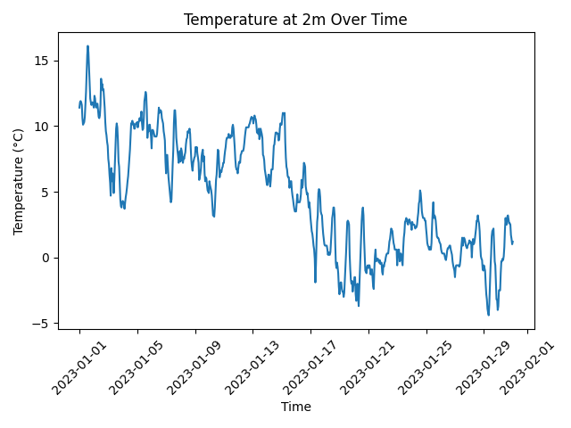

[](https://classroom.github.com/a/1RHvwtZb)
[](https://classroom.github.com/open-in-codespaces?assignment_repo_id=22606584)

# Reproducible Mini Weather Analysis

**Goal:** Build a small reproducible weather analysis workflow from an hourly CSV dataset and document how to run it locally and with Docker.


## Analysis script

`src/analyze_weather.py` contains a Python script that by means of `pandas` library computes and outputs the following information:
- minimum, maximum and average values for the `temperature_2m` field of the dataset;
- the mean value for `relative_humidity_2m`;
- the maximum value for `wind_speed_10m`;
- monthly aggregate values for `cloud_cover`.

## Weather Trend Plot

The script generates a temperature trend plot saved in `results/temperature_2m_trend.png`

Example output:




## Dockerfile

We created a Dockerfile to produce a stable and reproductible execution environment.

We used the official image `python:3.11-slim` as the base. This light version allows to reduce the size of the final image. 

We then defined the working directory and copied `src` and `data` folders into the container. 

The required library (`pandas`) is installed, and the default `CMD` is set to enable automatic execution of the analysis script whenever the container starts.


## Local run instructions
From the project root, execute: 
```
python src/analyze_weather.py
``` 
Or run with filters:
```
python src/analyze_weather.py --input data/weather_hourly.csv --start 2023-01-01 --end 2023-08-31 --min-temp 0
```

Arguments:
* `--input`: the path to the CSV file to be analyzed (`data/weather_hourly.csv` is used by default)

Filter options:
* `--start`: starting date from which the calculation begins
* `--end`: ending date at which the calculation stops
* `--min-temp`: minimum temperature required to be included in the calculation

Please note that data in `data/weather_hourly.csv` covers approximately the period between 1st January 2023 and 31st December 2023.


## Running with Docker

Build the image:
```
docker build -t weather-analysis .
```

Run the container:
```
docker run --rm weather-analysis
```

Example of usage with filters:
```
docker run --rm weather-analysis python src/analyze_weather.py --start 2023-04-01 --end 2023-08-31 --min-temp 0
```

## Example of expected output 

The temperature values:

  min  |  max   |  avg  
0.200 | 35.500 | 17.707

Mean relative humidity at 2 meters above ground: 67.802

Maximum wind speed at 10 meters above ground: 35.000

Monthly mean cloud cover:

2023-04: 71.774

2023-05: 63.672

2023-06: 36.842

2023-07: 59.503

2023-08: 58.191

2023-09: 46.003

2023-10: 71.669

2023-11: 81.401

2023-12: 89.369